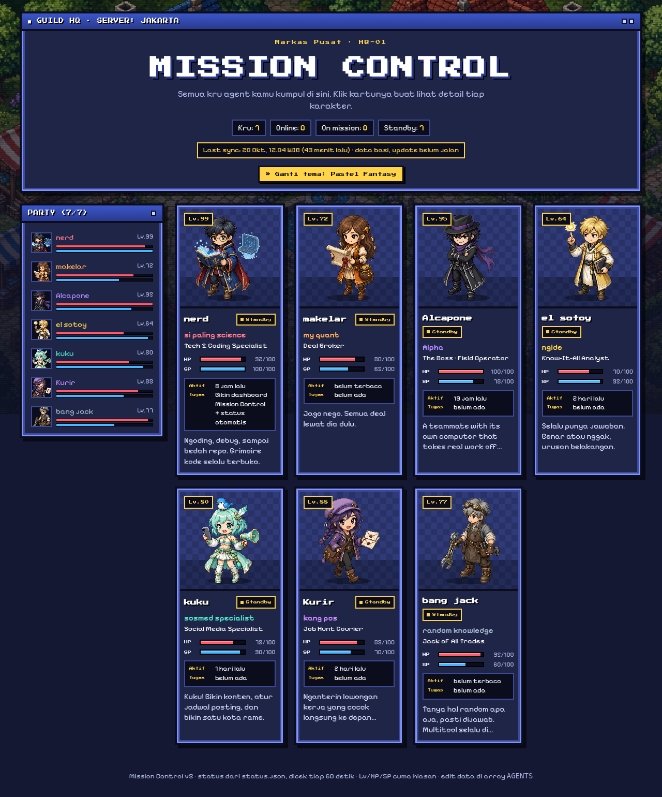

# Mission Control

Pixel-art anime dashboard that shows the owner's AI agents as animated characters.

A static site (plain HTML, CSS, and JavaScript, no build step). Each agent is a character in a guild-hall mission control: the default theme is a pixel RPG, and a second theme is a pastel fantasy look. Cards show a role, a short line, and live status loaded from `status.json`.

## Run locally

From the repository root:

```bash
python3 -m http.server
```

Open http://localhost:8000/.

## Theme

The pixel theme is the default. Open the pastel fantasy theme with `?theme=frieren` (for example http://localhost:8000/?theme=frieren). The choice is stored in the browser, and the button in the header toggles between the two.

## Status

`status.json` is refreshed by `update_status.py` on the owner's machine. The script reads local agent activity and writes `status.json` beside itself; it does not run in GitHub Actions. Optional short summaries live in `summaries.json`. The page reloads `status.json` about once a minute.

## Screenshot


